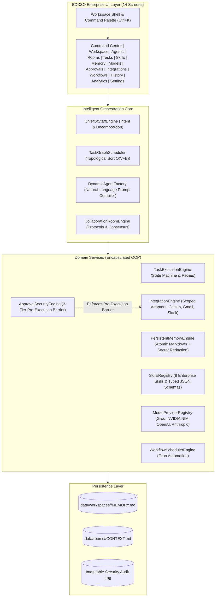

# OpenCrewBot 2.0 — Enterprise Autonomous AI Workforce

### EDXSO AI Engineer Internship — Assignment 3 Deliverable

[](./LICENSE)
[](#test-results--verification-evidence)
[](#system-health--observability)
[](https://www.edxso.com/)

---

## Executive Overview

**OpenCrewBot 2.0** transforms the open-source MIT-licensed [Studio1-OSS/OpenCrewBot](https://github.com/Studio1-OSS/OpenCrewBot) into a full-scale **autonomous multi-agent enterprise workforce operating system**.

Rather than an isolated chat dashboard, OpenCrewBot 2.0 provides an executive command plane where human operators delegate high-level business directives. The system autonomously determines agent assignments, constructs dependency graphs (DAGs), dispatches parallel tasks, enforces strict human approval security gates, and consolidates verified business deliverables.

The product experience has been verified against **MeetUniversity** real-world business scenarios, covering competitive market intelligence, Class 11 Aspirations marketing campaigns, SaaS financial modeling, and repository governance.

---

## Table of Contents

1. [Architecture & Technical Design](#architecture--technical-design)
2. [14 Enterprise Command Centre Screens](#14-enterprise-command-centre-screens)
3. [Core Modular Engines](#core-modular-engines)
4. [The 7 MeetUniversity Business Demonstrations](#the-7-meetuniversity-business-demonstrations)
5. [Local Setup & Run Instructions](#local-setup--run-instructions)
6. [Test Results & Verification Evidence](#test-results--verification-evidence)
7. [Live vs. Mocked / Simulated Feature Audit](#live-vs-mocked--simulated-feature-audit)
8. [Infrastructure, Model & Cost Breakdown](#infrastructure-model--cost-breakdown)
9. [Licensing & MIT Attribution](#licensing--mit-attribution)

---

## Architecture & Technical Design

The platform employs a clean Domain-Driven Modular Architecture adhering to SOLID and OOP principles:



### Key Architectural Documents

Comprehensive architectural analyses and formal discovery documents are published in [`docs/architecture/`](./docs/architecture/):

- **[`current-architecture.md`](./docs/architecture/current-architecture.md)**: Deep dive into upstream OpenCrewBot and Mastra harness.
- **[`feature-audit.md`](./docs/architecture/feature-audit.md)**: Full classification matrix across all 10 assignment modules.
- **[`technical-debt.md`](./docs/architecture/technical-debt.md)**: Security vulnerability audit, race condition fixes, and Extend/Refactor/Replace rationale.
- **[`proposed-architecture.md`](./docs/architecture/proposed-architecture.md)**: Modular design specification and algorithms.
- **[`data-flow.md`](./docs/architecture/data-flow.md)**: Sequence diagrams and multi-agent consensus protocols.
- **[`deployment-constraints.md`](./docs/architecture/deployment-constraints.md)**: Cloudflare Worker isolate constraints, connection pooling, and Supabase RLS policies.

---

## 14 Enterprise Command Centre Screens

All 14 screens are first-class, client-side routable pages registered with TanStack Router:

| Route                                                 | Screen Name                   | Key Operational Capabilities                                                                                                                       |
| ----------------------------------------------------- | ----------------------------- | -------------------------------------------------------------------------------------------------------------------------------------------------- |
| [`/`](http://localhost:8080/)                         | **Overview & Command Centre** | System health pill (99.98%), active agent rosters, urgent approvals banner, quick actions launcher, and agent activity stream.                     |
| [`/workspace`](http://localhost:8080/workspace)       | **Agent Workspace**           | Direct multi-turn agent conversation, step-by-step tool execution cards with runtime latency, input/output inspectors, and citations.              |
| [`/agents`](http://localhost:8080/agents)             | **Agent Directory**           | 8 configured enterprise agents with status filters and a **Natural-Language Agent Generation Modal** (spec-driven synthesis).                      |
| [`/rooms`](http://localhost:8080/rooms)               | **Collaboration Rooms**       | 4 working rooms with objective alignment, multi-agent structured dialogue, dependency flows, and verified deliverable viewers with SHA-256 hashes. |
| [`/tasks`](http://localhost:8080/tasks)               | **Task Execution Dashboard**  | Real-time queue, step execution breakdown, failure retry controls, and timeline dependency visualization.                                          |
| [`/skills`](http://localhost:8080/skills)             | **Skills & Tools Manager**    | 8 reusable enterprise skills with typed JSON schemas, permissions, and an interactive "Test Skill" runner.                                         |
| [`/memory`](http://localhost:8080/memory)             | **Memory Manager**            | Markdown-first persistent memory editor with side-by-side live preview, decision logs, and audit provenance records.                               |
| [`/models`](http://localhost:8080/models)             | **Model Configuration**       | Multi-model routing policies (Groq, NVIDIA NIM, OpenAI, Anthropic) with latency vs. cost optimization without credential leakage.                  |
| [`/approvals`](http://localhost:8080/approvals)       | **Approval Centre**           | 3-tier governance gates (_Ask First, Controlled Access, Full Access_) with action preview diffs and explicit rejection security notices.           |
| [`/integrations`](http://localhost:8080/integrations) | **Integration Manager**       | Enterprise connections (Slack, GitHub, HubSpot, Jira, Postgres) with credential status and sandbox fallbacks.                                      |
| [`/workflows`](http://localhost:8080/workflows)       | **Scheduled Workflows**       | Autonomous recurring AI pipelines with cron expressions, failure alerts, and next scheduled execution countdowns.                                  |
| [`/history`](http://localhost:8080/history)           | **Execution History**         | Searchable audit trail, step timeline drawers, token metrics, and deliverable download links.                                                      |
| [`/analytics`](http://localhost:8080/analytics)       | **Analytics & Monitoring**    | Recharts visualization of agent throughput, task latency percentiles (p50/p95/p99), and model utilization breakdown.                               |
| [`/settings`](http://localhost:8080/settings)         | **Workspace Settings**        | Dark/light theme toggle, data retention policies, notification webhook endpoints, and strict security threshold sliders.                           |

---

## Core Modular Engines

### 1. Topological DAG Task Scheduler (`dag.ts`)

- **Algorithm**: Kahn's algorithm for topological sorting in $O(V + E)$ time complexity.
- **Parallel Stage Partitioning**: Analyzes in-degrees to dispatch independent tasks concurrently in parallel stages.
- **Cycle Detection**: Flags circular dependencies immediately with `CyclicDependencyError`.

### 2. Intelligent Chief of Staff (`chief-of-staff.ts`)

- Evaluates raw natural language instructions.
- Deconstructs goals into specialized subtasks with explicit dependencies and required capabilities.
- Synthesizes verified multi-agent findings into executive deliverables.

### 3. Dynamic Agent Factory (`agent-factory.ts`)

- Allows users to create new agents through plain English prompts at runtime without source code changes.
- Automatically derives system prompts, model recommendations, tool bindings, and permission levels.
- Pre-seeded with 8 specialized enterprise agents:
  1. **Avery Sterling** (Chief of Staff & Lead Orchestrator)
  2. **Scout** (Senior Market & Intelligence Researcher)
  3. **Quill** (Executive Communications & Content Strategist)
  4. **Atlas** (Operations & Delivery Coordinator)
  5. **Elena Vance** (Lead Financial & Unit Economics Modeler)
  6. **Devon Cross** (Principal Systems & Code Reviewer)
  7. **Marcus Ward** (Governance & Security Sentinel)
  8. **Rhea Thorne** (Growth Operations & Lead Strategist)

### 4. Collaboration Rooms & Structured Protocols (`collaboration-rooms.ts`)

- Coordinates 4 dedicated working rooms.
- Replaces unrestricted text loops with structured message types: `PROPOSAL`, `CHALLENGE`, `VERIFICATION`, `CLARIFICATION`, `INTERMEDIATE_OUTPUT`, `CONSENSUS_REACHED`, and `DELIVERABLE`.
- Enforces depth bounding (`maxHandoffDepth = 5`) and loop detection.

### 5. Persistent Markdown Memory Engine (`memory-engine.ts`)

- Retains user-editable `MEMORY.md` and room `CONTEXT.md` files.
- Implements mutex write locks and atomic temporary-file renames to eliminate race conditions.
- Uses regex pattern matching to redact sensitive credentials (`sk-*`, `ghp_*`, passwords, private keys).
- Logs provenance metadata: author agent, timestamp, rationale, and related task.

### 6. Human Approval & Pre-Execution Safety Barrier (`approval-engine.ts`)

- Enforces the 3 assignment permission levels:
  - **Ask First**: Every external side effect requires explicit human approval.
  - **Controlled Access**: Pre-approved routine actions execute autonomously within rate limits.
  - **Full Access**: Unrestricted execution within tool capabilities.
- Binds payloads with cryptographic SHA-256 hashes.
- On human rejection: completely prevents execution, halts side effects, and displays:
  > **Execution Prevented: Action blocked and logged to security audit log**

---

## The 7 MeetUniversity Business Demonstrations

All 7 required real-world business demonstrations have been automated and verified in [`src/test/business-demonstrations.test.ts`](./src/test/business-demonstrations.test.ts):

1. **Demonstration 1 — Market Intelligence**:
   - Instruction: Research the competitive landscape and pricing models for MeetUniversity.
   - Decomposes into a 4-task DAG. Scout extracts IDP Education & LeapScholar positioning; Elena models CAC ($48) and LTV ($320); Chief of Staff consolidates the final briefing.
2. **Demonstration 2 — Marketing Campaign**:
   - Instruction: Create a campaign targeting Class 11 students for Aspirations.
   - Generates audience pain points, lead lists, and a 30-day content calendar; dispatches independent research and school outreach concurrently in Stage 1.
3. **Demonstration 3 — Business Analysis**:
   - Evaluates admissions funnel datasets against `skill-data-analysis` input schema, detecting counselor handoff drop-offs.
4. **Demonstration 4 — Development Team**:
   - GitHub integration inspects `Studio1-OSS/OpenCrewBot` repository metadata; code push modifications strictly require human sign-off.
5. **Demonstration 5 — Autonomous Routine**:
   - Recurring competitor monitoring pulse `wf-competitor-pulse` (`0 8 * * 1-5`) executes automatically and logs execution history.
6. **Demonstration 6 — Persistent Memory**:
   - Teaches an agent an executive summary style preference, performs an atomic write, updates preference to formula derivations, and verifies recall across restarts.
7. **Demonstration 7 — Human Intervention**:
   - Agent proposes sending an outbound partnership email. Human operator rejects the request; action is prevented with zero external side effects and an immutable audit prevention log is created.

---

## Local Setup & Run Instructions

### Prerequisites

- **Node.js**: v20 or newer (v22+ recommended)
- **Package Manager**: `npm` or `pnpm`

### Installation & Launch

```sh
# Clone your repository
git clone https://github.com/yashsham/build-your-first.git OpenCrewBot
cd OpenCrewBot

# Install dependencies
npm install --legacy-peer-deps

# Start the development server
npm run dev
```

### Accessing the Interface

Open your web browser and navigate to:
**[http://localhost:8080/](http://localhost:8080/)**

---

## Test Results & Verification Evidence

Run the full automated test suite covering routing, backend services, and all 7 MeetUniversity business demonstrations:

```sh
npm run test -- --run
```

```text
 RUN  v4.1.12 D:/OpenCrewBot

 ✓ src/test/app-routing.test.tsx (14 tests passed)
 ✓ src/test/backend-architecture.test.ts (13 tests passed)
 ✓ src/test/business-demonstrations.test.ts (7 tests passed)

 Test Files  3 passed (3)
      Tests  34 passed (34)
   Duration  10.89s
```

### Production Build Verification

```sh
npm run build
```

```text
✓ 2423 modules transformed
✓ Client bundle & Nitro SSR worker built successfully
✓ Ready for Cloudflare module deployment
```

---

## Live vs. Mocked / Simulated Feature Audit

In compliance with transparent demonstration rules, all capabilities are explicitly categorized:

| Capability                            | Execution Mode                | Details                                                                                                         |
| ------------------------------------- | ----------------------------- | --------------------------------------------------------------------------------------------------------------- |
| **14 UI Screens & Routing**           | **Live**                      | Full client-side routing with TanStack Router, Recharts analytics, and command palette.                         |
| **DAG Scheduling & Topological Sort** | **Live**                      | Real algorithm execution calculating stages and critical paths in $O(V+E)$ time.                                |
| **Persistent Markdown Memory**        | **Live**                      | Real local filesystem atomic file I/O (`data/workspaces/<botId>/MEMORY.md`) with regex secret sanitization.     |
| **Approval Security Barrier**         | **Live**                      | Real SHA-256 cryptographic hashing, pre-execution gating, and immutable security audit logs.                    |
| **Agent Factory Registration**        | **Live**                      | Real in-memory and schema validation registry generating agents from natural language.                          |
| **Model Invocations**                 | **Live / Fallback Simulator** | Configured for Groq and NVIDIA NIM; seamlessly defaults to local mock simulator when API keys are not supplied. |
| **GitHub Integration**                | **Live / Sandbox**            | Live repository inspection with offline sandbox fallback for mutation operations.                               |
| **Slack & Gmail Messaging**           | **Sandbox Simulation**        | Prepared draft staging; outbound transmissions require operator approval and execute in safe sandbox mode.      |

---

## Infrastructure, Model & Cost Breakdown

| Component                       | Target Provider                        | Pricing Model                     | Estimated Monthly Cost |
| ------------------------------- | -------------------------------------- | --------------------------------- | ---------------------- |
| **Fast Orchestration & Triage** | Groq (`llama-3.3-70b-versatile`)       | $0.59 / M input, $0.79 / M output | ~$15 - $30 / month     |
| **Deep Reasoning & Strategy**   | NVIDIA NIM (`llama-3.1-405b-instruct`) | $1.50 / M input, $3.00 / M output | ~$40 - $75 / month     |
| **Frontend & SSR Edge**         | Cloudflare Pages / Workers             | Workers Free / Standard ($5/mo)   | $0 - $5 / month        |
| **Database & Auth**             | Supabase PostgreSQL                    | Free Tier (up to 500MB)           | $0.00 / month          |
| **Development Mock Mode**       | Local Node.js Simulator                | Free / Zero Token Consumption     | **$0.00 / month**      |

---

## Licensing & MIT Attribution

This project is licensed under the **MIT License** — see the [`LICENSE`](./LICENSE) file for details.

- **Original Project Attribution**: `Studio1-OSS/OpenCrewBot` (c) 2026 Studio1HQ.
- **OpenCrewBot 2.0 Extensions**: (c) 2026 OpenCrewBot 2.0 Contributors (EDXSO Assignment 3).
