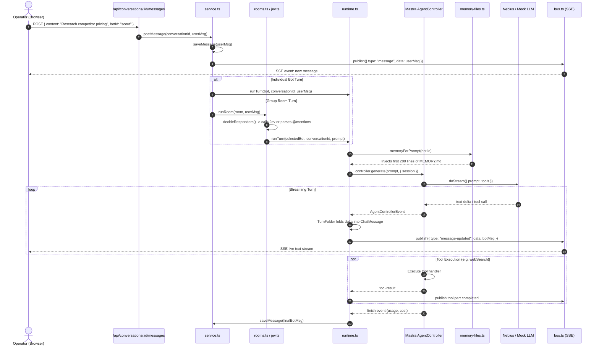

# OpenCrewBot (Current / Upstream Architecture)

**Repository Reference**: [Studio1-OSS/OpenCrewBot](https://github.com/Studio1-OSS/OpenCrewBot)  
**Licence**: MIT Licence  
**Framework**: Mastra (`@mastra/core` v1.76.0) + Next.js 16.4.0 (React 19)

---

## 1. Executive Architecture Summary

The original upstream `OpenCrewBot` is an open-source, local-first multi-agent chat interface designed as an alternative to proprietary multi-agent bots. Each bot maintains an independent persona, model configuration, Markdown-based memory file (`MEMORY.md`), and tool attachments (Web Search via Tavily, Cloud Browser via Browserbase, Code Execution via QuickJS sandbox, Composio apps, and remote MCP servers).

The backend is built as a single Node.js runtime process wrapping Mastra's `AgentController` with an in-memory session cache and LibSQL (SQLite) persistence for messages, bots, rooms, and settings.

```mermaid
graph TD
    subgraph Client ["Client Layer (Web Browser)"]
        UI["Chat UI / Sidebar / Details Drawer"]
        SSE_Client["EventSource (/api/events)"]
    end

    subgraph API ["Next.js App Router API Routes"]
        B_API["/api/bots"]
        R_API["/api/rooms"]
        C_API["/api/conversations/:id/messages"]
        A_API["/api/conversations/:id/approval"]
        CONN_API["/api/connections"]
        MOD_API["/api/models"]
    end

    subgraph Service ["Core Service Layer (src/lib/server)"]
        SVC["service.ts (Validation & Orchestration)"]
        RT["runtime.ts (AgentController Lifecycle)"]
        ROOMS["rooms.ts (Multi-Agent Routing & Handoffs)"]
        MEM["memory-files.ts (Markdown File IO)"]
        JEV["jev.ts (TypeSafe Decision Model)"]
        BUS["bus.ts (Server-Sent Events Pub/Sub)"]
    end

    subgraph Agent_Harness ["Mastra Agent Framework"]
        AC["AgentController (Per Bot)"]
        SESS["Session Store (In-Memory Map)"]
        LLM["Model Client (Nebius / Mock Model)"]
        TOOLS["Tools Registry (Tavily, Browserbase, QuickJS)"]
    end

    subgraph Storage ["Storage & External Providers"]
        LIBSQL[("app.db & mastra.db (LibSQL/SQLite)")]
        FS_MEM[("data/workspaces/<botId>/MEMORY.md")]
        TAVILY["Tavily Search API"]
        BBASE["Browserbase CDP"]
        COMPOSIO["Composio App Gateway"]
        MCP["Remote MCP Servers"]
    end

    UI --> API
    SSE_Client <.. BUS
    API --> SVC
    SVC --> RT
    SVC --> ROOMS
    SVC --> MEM
    ROOMS --> JEV
    RT --> AC
    AC --> SESS
    AC --> LLM
    AC --> TOOLS
    SVC --> LIBSQL
    MEM --> FS_MEM
    TOOLS --> TAVILY
    TOOLS --> BBASE
    TOOLS --> COMPOSIO
    TOOLS --> MCP
```

---

## 2. Component-by-Component Technology Stack

| Layer                     | Upstream Technology                                           | File Location                                                 | Purpose & Characteristics                                                                                                                    |
| ------------------------- | ------------------------------------------------------------- | ------------------------------------------------------------- | -------------------------------------------------------------------------------------------------------------------------------------------- |
| **Frontend UI**           | Next.js 16.4.0, React 19.3.0, Tailwind CSS 4, Lucide Icons    | `src/app/`, `src/components/`                                 | Conversational multi-bot messenger interface with sidebar, chat pane, bot/room inspector drawers, and Markdown rendering (`react-markdown`). |
| **Streaming & Transport** | Server-Sent Events (SSE), Node `EventEmitter`                 | `src/lib/server/bus.ts`, `src/app/api/events/route.ts`        | Streams text deltas, tool executions, approval cards, and agent status changes to browser without WebSockets.                                |
| **Agent Controller**      | `@mastra/core` (1.76.0) `AgentController`                     | `src/lib/server/runtime.ts`                                   | Manages LLM loop, thread session memory, tool call execution, and tool approval pauses (`ask_user`).                                         |
| **Model Invocations**     | Nebius Token Factory / `MastraLanguageModelV2Mock`            | `src/lib/server/models.ts`, `src/lib/server/mock-model.ts`    | Default: `MiniMaxAI/MiniMax-M3`. Fallback to local scriptable `createMockModel` when `NEBIUS_API_KEY` is omitted.                            |
| **Room Orchestration**    | Jev (`https://api.typesafe.ai/v1/systemone`) + Regex mentions | `src/lib/server/rooms.ts`, `src/lib/server/jev.ts`            | Multiple-choice decision model router for group rooms with max 2-hop handoffs (`MAX_HANDOFF_DEPTH = 2`).                                     |
| **Persistent Memory**     | Local file system (`node:fs`)                                 | `src/lib/server/memory-files.ts`                              | `data/workspaces/<botId>/MEMORY.md`. 200 lines / 16KB prompt limit with regex secret redaction.                                              |
| **Database**              | `@libsql/client` (SQLite via LibSQL)                          | `src/lib/server/db.ts`                                        | Two databases: `data/app.db` (bots, rooms, messages, settings) and `data/mastra.db` (Mastra thread sessions).                                |
| **Integrations**          | `@composio/core`, `@mastra/mcp`                               | `src/lib/server/composio.ts`, `src/lib/server/mcp-servers.ts` | Composio OAuth app proxying and custom remote MCP server connections via SSE/HTTP.                                                           |

---

## 3. Detailed Request Lifecycle Trace



---

## 4. Upstream Strengths & Architectural Baseline

1. **Separation of Model History vs App Messages**: Mastra maintains its internal state in `mastra.db`, while OpenCrewBot persists presentation chat parts in `app.db`.
2. **Transparent Tool Steps**: Tool execution events (`running`, `complete`, `denied`) are stored as distinct parts on the message object, enabling rich UI cards.
3. **Editable Markdown Memory**: Having human-readable `MEMORY.md` files provides inspectability and prevents vendor lock-in.
4. **Resilient Local Mock Mode**: Complete offline testing path through `mock-model.ts` without incurring token costs or requiring external API keys.
