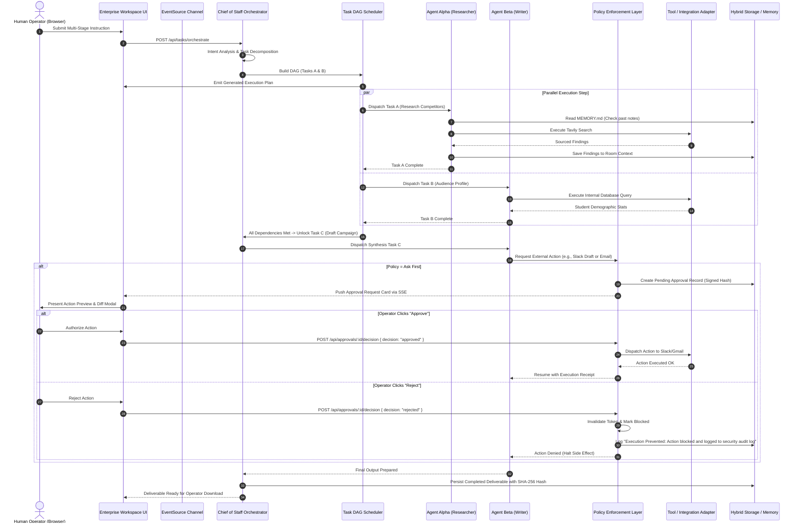
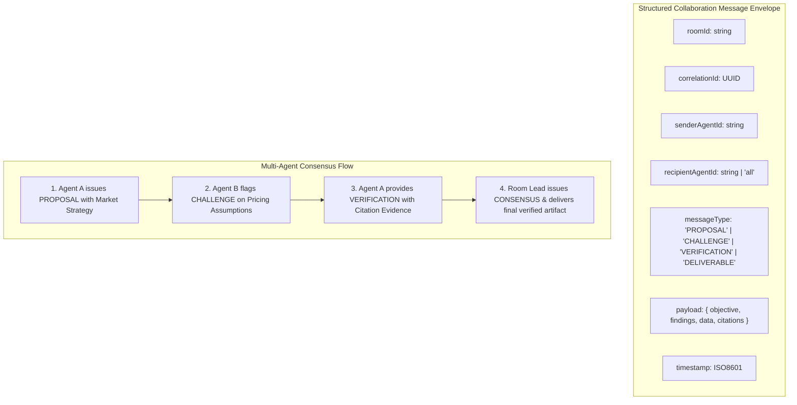
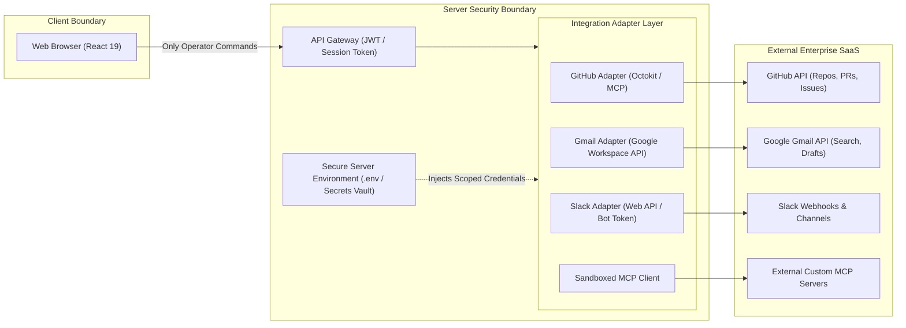
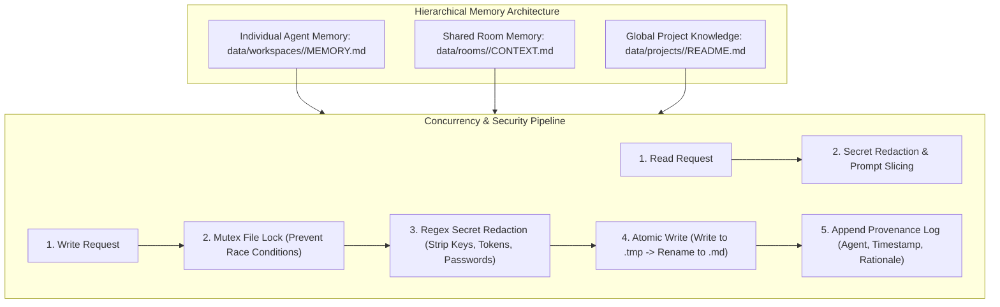

# OpenCrewBot 2.0 — End-to-End Data Flow & Integration Architecture

**Assignment Reference**: EDXSO AI Engineer Internship Assignment 3  
**Focus**: Request Lifecycles, Multi-Agent Inter-Communication, Integration Adapters & Approval Pipelines

---

## 1. End-to-End Request & Data Flow

---

## 2. Multi-Agent Room Communication Protocol

In Collaboration Rooms, agents communicate through structured typed messages rather than unstructured text. This prevents circular hallucinations and provides transparent auditability.

---

## 3. Integration Architecture & Credential Boundary

OpenCrewBot 2.0 isolates third-party enterprise tools behind secure, sandboxed integration adapters. Privileged credentials never reach the browser client.

---

## 4. Persistent Memory Architecture & Synchronization

