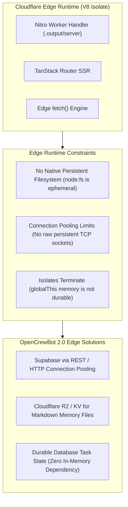

# OpenCrewBot 2.0 — Deployment Constraints & Infrastructure Compatibility

**Assignment Reference**: EDXSO AI Engineer Internship Assignment 3  
**Target Environments**: Cloudflare Workers/Pages (Nitro SSR), Local Node.js Runtime, Supabase Cloud, Groq & NVIDIA NIM

---

## 1. Cloudflare Workers / Nitro SSR Deployment Constraints

The application utilizes Nitro and Vite to compile into a `cloudflare-module` target. Deploying multi-agent workloads to Cloudflare edge environments introduces specific architectural constraints:



### Detailed Constraints & Mitigations

1. **Filesystem vs. Cloudflare Storage**:
   - _Constraint_: Upstream `memory-files.ts` writes directly to the local disk (`data/workspaces/<botId>/MEMORY.md`) using `node:fs`. In a Cloudflare Worker, disk writes throw errors or evaporate on container recycling.
   - _Mitigation_: The `PersistentMemoryEngine` implements a dual-adapter pattern: `LocalFileSystemAdapter` when running in Node.js local dev (`pnpm dev`), and `RemoteStorageAdapter` (Cloudflare R2 / Supabase Storage) when deployed to Cloudflare.
2. **Database Connection Limits**:
   - _Constraint_: Standard PostgreSQL drivers opening direct TCP connections exhaust database connection pools on serverless edge invocation spikes.
   - _Mitigation_: Route Supabase PostgreSQL queries through Supabase Connection Pooler (Transaction mode, port 6543) or Cloudflare Hyperdrive.
3. **Stateless Edge Execution**:
   - _Constraint_: In-memory task queues or promise chains (`runningBots` map) are lost if a Worker isolate is recycled.
   - _Mitigation_: Every task state transition (`PENDING` -> `RUNNING` -> `COMPLETED`) is written durably to the database before the next step executes.

---

## 2. LLM Provider Compatibility Matrix

OpenCrewBot 2.0 eliminates single-provider lock-in by providing a unified adapter supporting:

| Provider        | API Standard                                              | Tested Models                                                     | Tool-Calling Support                         | Latency Profile                       | Primary Use Case in OpenCrewBot 2.0                                              |
| --------------- | --------------------------------------------------------- | ----------------------------------------------------------------- | -------------------------------------------- | ------------------------------------- | -------------------------------------------------------------------------------- |
| **Groq**        | OpenAI-compatible (`https://api.groq.com/openai/v1`)      | `llama-3.3-70b-versatile`, `mixtral-8x7b-32768`                   | Native function calling                      | **Ultra-Low (<150ms TTFT)**           | Chief of Staff fast intent classification, agent routing, and rapid triage.      |
| **NVIDIA NIM**  | OpenAI-compatible (`https://integrate.api.nvidia.com/v1`) | `meta/llama-3.1-405b-instruct`, `nvidia/nemotron-4-340b-instruct` | Supported                                    | High throughput, high parameter depth | Deep strategic business analysis, financial modelling, and complex code reviews. |
| **OpenAI**      | Official API (`https://api.openai.com/v1`)                | `gpt-4o`, `gpt-4o-mini`, `o3-mini`                                | Native function calling + Structured Outputs | Enterprise standard                   | Complex deliverable synthesis and multi-step reasoning.                          |
| **Anthropic**   | Anthropic Messages API (`https://api.anthropic.com/v1`)   | `claude-3-5-sonnet`, `claude-3-5-haiku`                           | Native tool use                              | High coding & nuanced writing quality | Content drafting, long-context memory synthesis, and presentation generation.    |
| **Mock Engine** | Local Scripted Generator                                  | `mock-model-v2`                                                   | Full simulation                              | **Instant (0ms latency)**             | Offline developer testing and evaluation without API keys.                       |

---

## 3. Supabase & Database Architecture

When persisting structured workforce data to Supabase PostgreSQL, strict enterprise security policies are enforced:

### A. Row Level Security (RLS) Policy Design

```sql
-- Workspace Isolation Policy
ALTER TABLE agents ENABLE ROW LEVEL SECURITY;
ALTER TABLE tasks ENABLE ROW LEVEL SECURITY;
ALTER TABLE approvals ENABLE ROW LEVEL SECURITY;

-- Agents policy: Users can only access agents in their tenant workspace
CREATE POLICY workspace_agent_isolation ON agents
    FOR ALL
    USING (workspace_id = auth.jwt() ->> 'workspace_id');

-- Approvals policy: Only workspace admins can approve sensitive actions
CREATE POLICY workspace_approval_enforcement ON approvals
    FOR UPDATE
    USING (workspace_id = auth.jwt() ->> 'workspace_id'
           AND (auth.jwt() ->> 'role') = 'workspace_admin');
```

### B. Secret & Credential Handling

- **Rule 1**: Service-role API keys (`SUPABASE_SERVICE_ROLE_KEY`) are restricted strictly to server-side Nitro endpoints and are NEVER bundled into client-side browser code.
- **Rule 2**: Secrets added in Settings or Integrations (e.g. GitHub PATs, Slack Bot Tokens) are encrypted at rest using AES-GCM before writing to the database.
