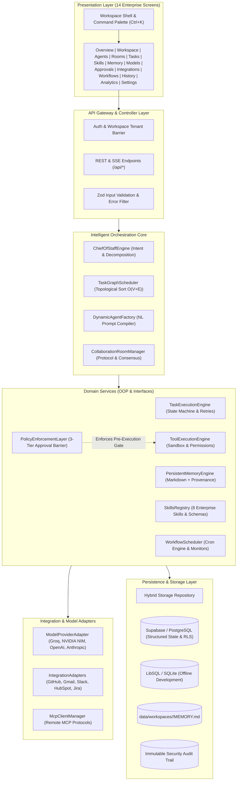
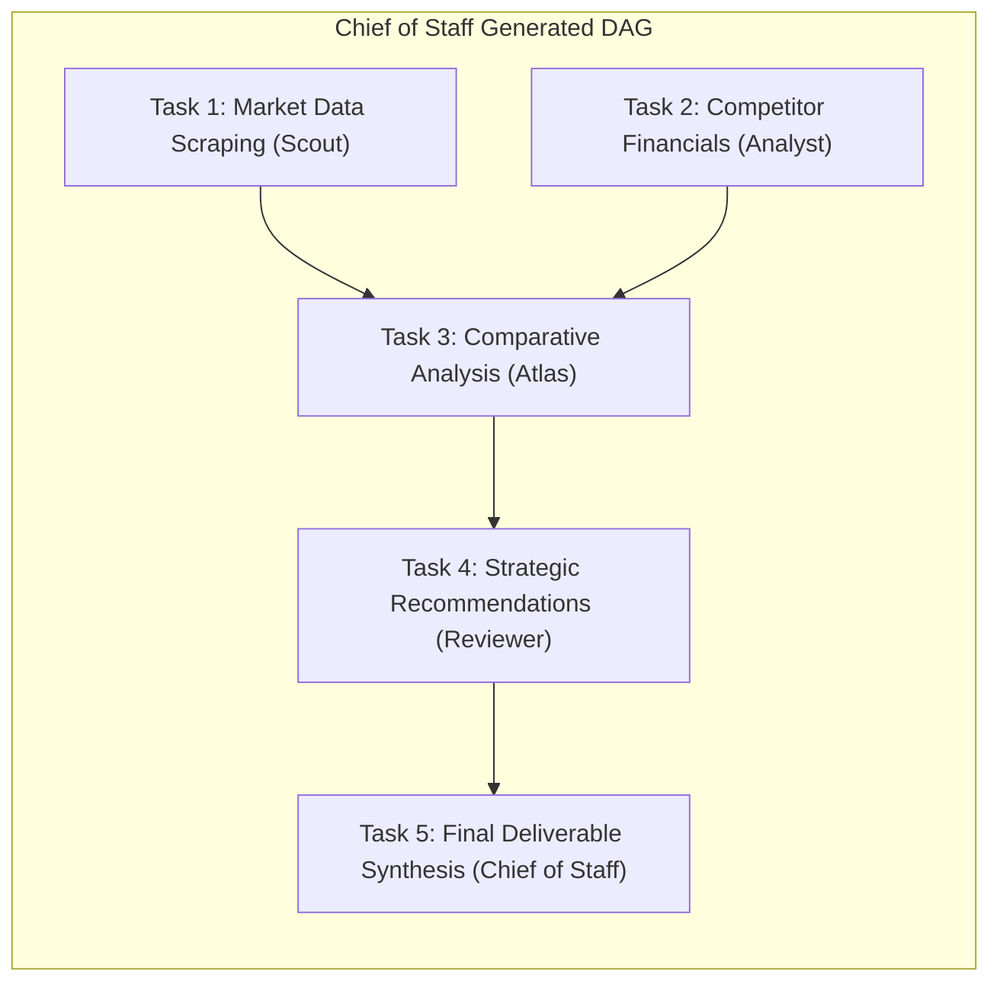
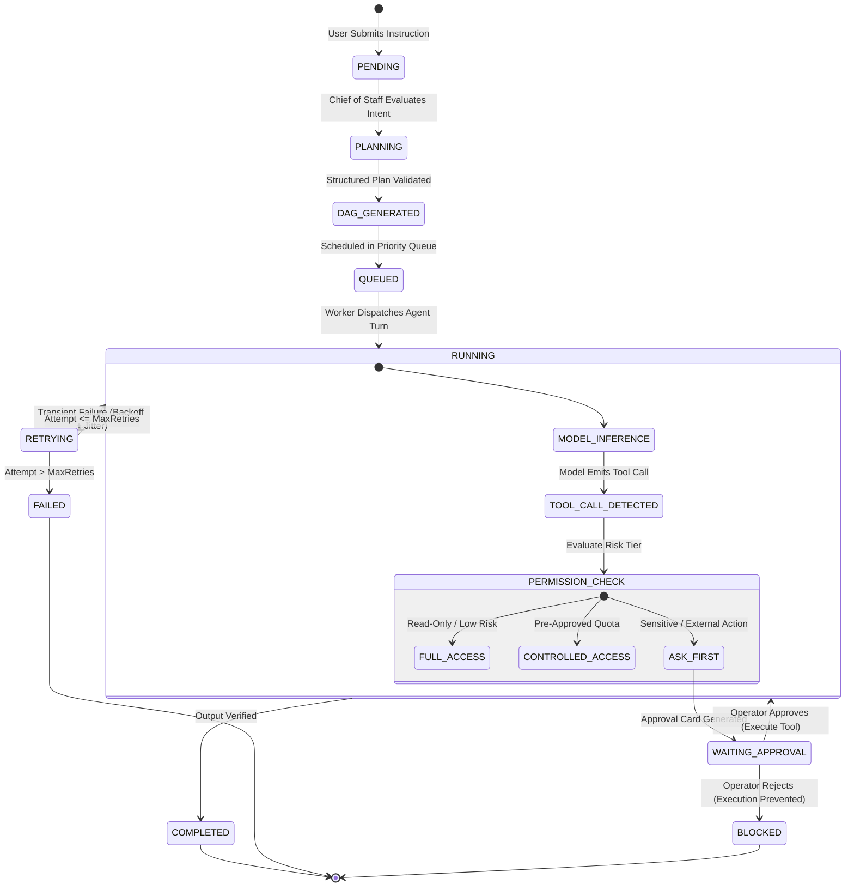

# OpenCrewBot 2.0 — Proposed Backend Architecture & Modular Engineering

**Assignment Reference**: EDXSO AI Engineer Internship Assignment 3  
**Architecture Paradigm**: Modular Enterprise Architecture, Domain-Driven Design (DDD), SOLID Principles & OOP Abstraction

---

## 1. System Architecture Overview

OpenCrewBot 2.0 re-architects the single-file procedural runtime into a high-reliability, modular enterprise multi-agent operating system. It decouples high-level business orchestration from concrete LLM execution and storage adapters.

---

## 2. Core Modules & OOP / SOLID Principles

Every module is designed with strict boundaries, interfaces, and separation of concerns:

| Module                    | Core Interface / Class             | OOP & SOLID Application                       | Responsibility                                                                                                           |
| ------------------------- | ---------------------------------- | --------------------------------------------- | ------------------------------------------------------------------------------------------------------------------------ |
| **Chief of Staff**        | `IChiefOfStaffEngine`              | Single Responsibility (SRP)                   | Deconstructs complex natural-language goals into structured dependency graphs (DAGs).                                    |
| **Dynamic Agent Factory** | `IAgentFactory`                    | Factory Pattern, Open/Closed (OCP)            | Generates valid agent configurations from user prompts without modifying source code.                                    |
| **Collaboration Rooms**   | `IRoomCollaborationEngine`         | Mediator Pattern                              | Coordinates agent-to-agent dialogue, manages shared context, and detects circular loops.                                 |
| **Task Execution**        | `ITaskExecutionEngine`             | State Pattern, Command Pattern                | Manages task state transitions (`PENDING` -> `QUEUED` -> `RUNNING` -> `COMPLETED`/`FAILED`), retries, and interruptions. |
| **Skills & Tools**        | `ISkillsRegistry`, `IToolRegistry` | Strategy Pattern, Interface Segregation (ISP) | Validates input/output JSON schemas, tests payloads, and binds permissions.                                              |
| **Policy Enforcement**    | `IPolicyEnforcementService`        | Proxy / Guard Pattern                         | Blocks sensitive side effects prior to execution until approved by human operator.                                       |
| **Model Providers**       | `IModelProvider`                   | Liskov Substitution (LSP), Polymorphism       | Unified abstraction over Groq, NVIDIA NIM, OpenAI, and Anthropic with automatic fallback.                                |
| **Memory Engine**         | `IPersistentMemoryStore`           | Repository Pattern                            | Atomic read/write of Markdown files with versioning, secret redaction, and audit provenance.                             |

---

## 3. Data Structures & Algorithms

To ensure predictable performance under heavy enterprise agent workloads, all core operations utilize mathematically verified data structures:

### A. Task Dependency DAG & Topological Scheduling

- **Data Structure**: Directed Acyclic Graph (DAG) represented as an Adjacency List: `Map<TaskId, Set<TaskId>>`.
- **Algorithm**: Kahn's Topological Sorting Algorithm with in-degree array:
  - Detects circular dependencies in $O(V + E)$ time.
  - Identifies independent tasks (in-degree = 0) to schedule them concurrently in parallel worker pools.
  - Sequentially unlocks dependent tasks upon parent task completion.

### B. Cycle Detection in Agent Collaboration Handoffs

- **Data Structure**: Handoff Call Stack `Array<{ fromAgent: string, toAgent: string, depth: number }>` and Visitation Set `Set<string>`.
- **Algorithm**: Depth-bounded cycle detection with execution budget:
  - Handoff depth capped at 5 hops.
  - Immediate termination if a cycle $(A \to B \to A)$ is detected without new intermediate data.

### C. O(1) Fast Lookups

- Agent directory, active room sessions, and pending approval tokens are indexed using Hash Maps (`Map<string, T>`) providing $O(1)$ lookup complexity.

---

## 4. Agent Execution Lifecycle State Machine

