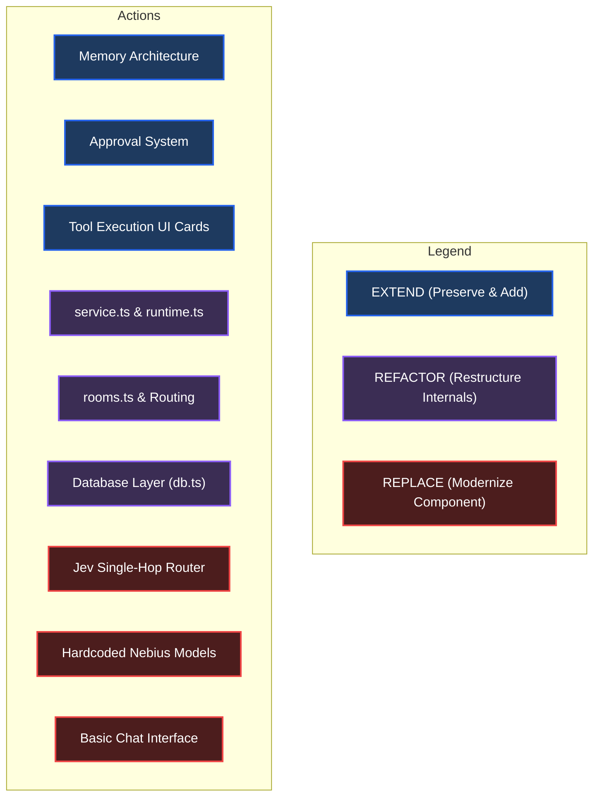

# OpenCrewBot Technical Debt & Vulnerability Analysis

**Target Assignment**: EDXSO AI Engineer Internship Assignment 3 — OpenCrewBot 2.0  
**Audit Target**: `Studio1-OSS/OpenCrewBot` Codebase

---

## 1. Security Weaknesses & Vulnerability Assessment

### A. Global State Pollution & Concurrency Hazards

- **Location**: `src/lib/server/runtime.ts` (`globalThis.__opencrewbotRuntime`), `src/lib/server/db.ts` (`globalThis.__opencrewbotDb`), `src/lib/server/service.ts` (`globalThis.__opencrewbotBoot`).
- **Risk**: In-memory `Map` instances (`sessions`, `chains`, `running`, `folders`) are stored on `globalThis` to survive Next.js Fast Refresh. In a production cluster or edge worker, this leaks memory over time, produces cross-request race conditions, and fails completely if requests hit different worker processes.
- **Remediation**: Transition session tracking and task states to a durable database (PostgreSQL / Supabase or distributed LibSQL) with optimistic concurrency control.

### B. Path Traversal & Unbounded File System Access

- **Location**: `src/lib/server/memory-files.ts`:
  ```typescript
  export function workspaceDir(botId: string): string {
    const dir = join(WORKSPACES_DIR, botId.replace(/[^a-zA-Z0-9_-]/g, ""));
    mkdirSync(dir, { recursive: true });
    return dir;
  }
  ```
- **Risk**: While basic alphanumeric replacement exists, workspace folders are created directly in the local file system without checking disk quotas, symlink attacks, or cross-tenant workspace isolation.
- **Remediation**: Enforce strict workspace-scoped UUID validation and sandbox memory writes within tenant-isolated storage buckets or databases.

### C. Approval Bypass via Race Conditions

- **Location**: `src/lib/server/runtime.ts` and `src/app/api/conversations/[id]/approval/route.ts`.
- **Risk**: Upstream relies on in-memory promise resolution to unblock a waiting tool execution. If the Node.js process restarts while an approval is pending, `sweepInterrupted()` marks the message as `stopped`, but does not generate a permanent security audit record. If an attacker replays the approval payload with a different tool call, the server does not cryptographically verify the original action payload.
- **Remediation**: Cryptographically hash the action payload (tool name + arguments + timestamp) into an immutable Approval Request record before presenting it to the operator. Prevent execution unless the signed hash matches exactly.

---

## 2. Hardcoded Configurations & Fragility

| Component                              | Upstream Hardcoded Values                                                                                             | Architectural Impact                                                                                                                                         |
| -------------------------------------- | --------------------------------------------------------------------------------------------------------------------- | ------------------------------------------------------------------------------------------------------------------------------------------------------------ |
| **Model Catalog** (`models.ts`)        | Hardcoded array of 18 models and fixed per-token pricing table (`STATIC: Row[]`). Nebius Token Factory URL hardcoded. | Any price change or new model release requires a code commit and redeployment. Does not accommodate Groq, NVIDIA NIM, OpenAI, or Anthropic.                  |
| **Room Routing** (`jev.ts`)            | Hardcoded Jev URL (`https://api.typesafe.ai/v1/systemone`), timeout (`2500ms`), and confidence threshold (`0.55`).    | Fails if Jev API is down or unreachable, with no alternative fallback routing strategy other than falling back to the room lead.                             |
| **Collaboration Handoff** (`rooms.ts`) | Hardcoded `const MAX_HANDOFF_DEPTH = 2`.                                                                              | Cannot support complex business workflows requiring multi-stage verification (e.g., Planner -> Researcher -> Financial Analyst -> Reviewer -> Consolidator). |
| **Memory Buffer** (`memory-files.ts`)  | Hardcoded `lines: 200, bytes: 16 * 1024`.                                                                             | Truncates relevant context if the memory file exceeds 200 lines, with zero semantic ranking or relevance filtering.                                          |

---

## 3. Scalability Bottlenecks

1. **SQLite Database Locking**: Upstream uses `@libsql/client` with local file URLs (`file:data/app.db`). Under concurrent multi-agent workloads where 4+ bots write memory, transcript messages, and settings simultaneously, SQLite throws `SQLITE_BUSY: database is locked` errors.
2. **In-Memory Event Bus**: `src/lib/server/bus.ts` utilizes Node.js `EventEmitter`. Events only publish to clients connected to that exact Node.js process instance. Horizontal scaling behind a load balancer is impossible without Redis or PostgreSQL `LISTEN`/`NOTIFY`.
3. **No Durable Background Job Queue**: Tasks run as fire-and-forget in-memory promises. If an agent task takes 3 minutes and the client disconnects or the container restarts, the task is terminated and cannot be resumed.

---

## 4. Component Rationalization: Extend, Refactor, or Replace



### Detailed Justifications

1. **EXTEND**:
   - **Markdown Memory Engine**: Preserve the transparent `MEMORY.md` file layout beloved by users, but extend it with file locking, version history, audit provenance, and shared project memory.
   - **Approval Cards**: Preserve the interactive card UI, but extend it with a 3-tier security model (Ask First, Controlled Access, Full Access) and cryptographic prevention logging.

2. **REFACTOR**:
   - **`runtime.ts` & `service.ts`**: Deconstruct giant procedural service files into modular OOP services with Dependency Injection, centralized error handling, and structured validation.
   - **`db.ts` Storage Layer**: Refactor to support PostgreSQL / Supabase connection pooling and Cloudflare Hyperdrive compatibility while maintaining SQLite local-development compatibility.

3. **REPLACE**:
   - **`jev.ts` Single-Hop Routing**: Replace with an **Intelligent Chief of Staff Orchestrator** capable of full intent parsing, DAG task decomposition, parallel scheduling, and deliverable consolidation.
   - **`models.ts` Hardcoded Catalog**: Replace with a dynamic provider registry supporting Groq, NVIDIA NIM, OpenAI, Anthropic, and local endpoints.
   - **Single-Screen Chat UI**: Replace with the comprehensive 14-screen EDXSO Enterprise AI Workforce Command Centre.
